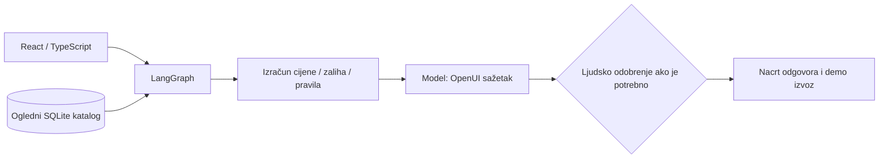
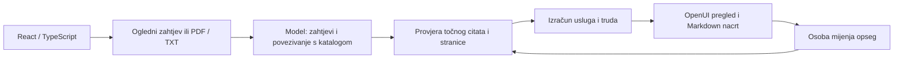

# Dva poslovna AI demoa koja možete sami pokrenuti

**Izradio Petar Vuković.** Dvije dovršene, lokalno pokretljive demo aplikacije pokazuju kako AI može pomoći u konkretnom poslovnom poslu: pripremi prodajne ponude i pretvaranju projektnog zahtjeva klijenta u pregledan nacrt ponude.

[English](README.md) · [Petrova web stranica](https://petarvukovic.tech) · [Izvorni kod](https://github.com/PetarVukovic/ai-agent-showcase)

## 1. AI Operations Desk — od upita kupca do provjerene ponude

Ručna provjera zaliha, rokova i popusta usporava odgovor kupcu. Operations Desk okuplja te provjere na jednom mjestu: odaberite proizvod i količinu, pogledajte izračun ponude, provjerite dostupnu alternativu i odobrite ili odbijte popust koji traži odluku odgovorne osobe.

**Isprobajte:** pripremite ogledni upit za 40 stolaca uz 12% popusta. Pregledajte iznos i odobrite popust. Zatim odaberite neizvediv zahtjev i dostupnu alternativu. Ništa se ne šalje kupcu i zaliha se ne rezervira.

- [Upute za aplikaciju](ai-operations-desk/README.md)
- Nakon pokretanja: **http://127.0.0.1:5174**

## 2. AI Proposal Studio — od dugog dokumenta do jasnije ponude

Važni zahtjevi lako se izgube među stranicama, a ponuda može obećati posao koji nije stvarno uključen. Proposal Studio izdvaja odabrane zahtjeve, prikazuje točne izvorne odlomke, označava otvorena pitanja i omogućuje uključivanje ili isključivanje usluga prije izvoza nacrta.

**Isprobajte:** otvorite Northstar, provjerite jedan izvorni odlomak, isključite API integraciju iz opsega i ažurirajte ponudu. Ogledni iznos smanjuje se za 1.800 €, a isključena usluga jasno se označava. Cijene su ilustrativne i nisu stvarna komercijalna ponuda.

- [Upute za aplikaciju](ai-proposal-studio/README.md)
- Nakon pokretanja: **http://127.0.0.1:5175**
- Uključena su dva izmišljena projektna zahtjeva s oglednim PDF/TXT datotekama.

Obje aplikacije imaju hrvatsko i englesko sučelje. Jasno označeni ogledni način radi bez ključa modela, a Gemini/OpenAI možete konfigurirati za stvarnu AI obradu. Odluka i završni pregled nacrta ostaju u vašim rukama.

## Pokrenite sami

Ovo su lokalne aplikacije: preuzmite repozitorij i pokrenite bilo koju zasebno. Objava izvornog koda ne postavlja aplikacije na hosting i ne pruža javni servis.

```sh
git clone https://github.com/PetarVukovic/ai-agent-showcase.git
cd ai-agent-showcase
```

## Instalacija

Potrebni su Python 3.12, Node.js s npm-om i [uv](https://docs.astral.sh/uv/). Sljedeće naredbe pokreću se iz korijena preuzetog repozitorija.

Operations Desk:

```sh
cd ai-operations-desk/backend
uv sync --frozen
cp .env.example .env
cd ../frontend
npm ci
```

Proposal Studio, u drugom terminalu iz korijena repozitorija:

```sh
cd ai-proposal-studio
uv venv .venv --python 3.12
uv pip install --python .venv/bin/python -r requirements.lock.txt
cp .env.example .env
cd frontend
npm ci
```

Oba demoa mogu raditi bez API ključa u jasno označenom oglednom načinu.

## Konfiguracija modela i ključeva

Operations Desk koristi `ai-operations-desk/backend/.env`, a Proposal Studio `ai-proposal-studio/.env`. Kopirajte odgovarajući `.env.example` i unesite samo ključ pružatelja kojeg želite koristiti:

```dotenv
OPENAI_API_KEY=your-own-key
OPENAI_MODEL=gpt-4.1-mini
GOOGLE_API_KEY=your-own-key
GEMINI_MODEL=gemini-3.5-flash-lite
LANGSMITH_TRACING=false
```

Možete postaviti i `PROVIDER_ENV_FILE=/absolute/path/to/provider.env`. Iz te datoteke čita se **samo `GOOGLE_API_KEY`**, bez uvoza ostalih postavki. Izravno postavljen `GOOGLE_API_KEY` ima prednost. Proposal Studio prihvaća i izravni `GEMINI_API_KEY`.

Ključevi ne smiju biti u React kodu, `VITE_*` varijablama, snimkama zaslona ni commitovima. `.gitignore` isključuje lokalne konfiguracije, baze, učitane i privatne dokumente te stanje izvršavanja, a zadržava `.env.example` i sintetičke primjere. Gemini se odabire kada je konfiguriran; inače odaberite dostupan model ili ogledni način. API pozivi mogu se naplaćivati. U načinu s modelom tekst upita ili dokumenta šalje se odabranom pružatelju.

## Pokretanje oba demoa

U četiri terminala, iz korijena repozitorija:

```sh
sh ai-operations-desk/start-backend.sh
```

```sh
sh ai-operations-desk/start-frontend.sh
```

```sh
sh ai-proposal-studio/start-backend.sh
```

```sh
sh ai-proposal-studio/start-frontend.sh
```

API dokumentacija dostupna je na `/docs` svakog Agent Servera. Svako sučelje ima i statične opisne stranice `/about/` i `/hr/about/`, s tekstom dostupnim bez JavaScripta. To su lokalne stranice dok aplikacije nisu javno postavljene.

## Provjere

Operations Desk, iz `ai-operations-desk/backend`:

```sh
.venv/bin/python -m unittest test_workflow -v
```

Proposal Studio, iz `ai-proposal-studio`:

```sh
.venv/bin/pytest -q
```

Iz `frontend` mape bilo kojeg projekta:

```sh
npm run build
```

Proposal Studio uključuje `frontend/test-ui.tsx` za provjeru OpenUI parsera (`npx tsx test-ui.tsx`). `scripts/test_http.py` provjerava pokrenuti HTTP API i izvršava jedan stvarni Gemini poziv; koristite ga namjerno. Taj test trenutačno očekuje konfiguriran Gemini i nekonfiguriran OpenAI u testnom okruženju.

Provjereni su stvarni Gemini pozivi, citati, deterministički izračuni, odobrenje i nastavak rada, neispravni ulazi i promjena opsega. Detalji su u README datotekama aplikacija. Prolazak provjera ne znači spremnost za produkciju.

## Što treba znati

Poslovni subjekti, katalog, cijene i zalihe su izmišljeni ogledni podaci. Iznosi su bez PDV-a. Procijenjeni trud nije obećani rok isporuke. Proposal Studio pregledava odabrane zahtjeve, a ne svaki mogući uvjet; uvijek provjerite izvorni dokument i nacrt. Izdvaja postojeći tekst iz PDF-a i ne izvršava OCR.

Aplikacije su lokalni demonstracijski primjeri. Nemaju produkcijsku autentikaciju, ograničenja korištenja ni produkcijsko postavljanje. Stvarni Gemini/OpenAI pozivi mogu se naplaćivati i šalju odgovarajući tekst odabranom pružatelju. Greške se prikazuju, bez tihog prebacivanja na ogledne rezultate.

Za kratku snimku pogledajte [SNIMANJE.md](SNIMANJE.md). Bilješke za sadržaj i pretraživanje nalaze se u [SEO-GEO.md](SEO-GEO.md), bez obećanja rangiranja ili citiranja u AI odgovorima.

<details>
<summary>Tehnička arhitektura i točna uloga svakog agenta</summary>

## AI Operations Desk: prodajna ponuda uz poslovna pravila

Kupac traži proizvod, količinu, rok i popust. Aplikacija čita **sintetički SQLite katalog**, provjerava zalihe i rok te izračunava cijenu. Demonstracijsko pravilo traži ljudsko odobrenje za popust iznad **8%**. LangGraph stvarno zaustavlja izvršavanje preko `interrupt()` i nastavlja tek nakon odluke. Odobrenje je vezano uz točnu verziju ponude i ne može zaobići nedostatnu zalihu ili neizvediv rok.

Gemini ili OpenAI piše kratak poslovni sažetak u OpenUI formatu. **Model ne računa cijene, ne odobrava popuste, ne mijenja zalihu i ne šalje narudžbu.** Nacrt odgovora sastavlja se iz provjerenog ishoda. U jasno označenom demo načinu sažetak dolazi iz pravila, bez poziva modelu.

Stvarni čvorovi grafa: `validate_request` → `check_catalog` → `calculate_quote` → `compose_brief` → `review_quote` → `prepare_reply`.



Gotovi scenariji prikazuju popust koji traži odobrenje, nedostupnu količinu ili rok te dostupnu alternativu. Ništa se ne šalje kupcu i zaliha se ne rezervira.

## AI Proposal Studio: analiza zahtjeva s provjerljivim izvorima

Odaberite sintetički projektni zahtjev ili učitajte tekstualni PDF/TXT. Model izdvaja odabrane zahtjeve, povezuje ih s definiranim katalogom usluga i predlaže pitanja za razjašnjenje. Kod provjerava svaki prikazani **citat i broj stranice** prema stvarnom tekstu dokumenta. Neprovjerljivi navodi uklanjaju se uz upozorenje.

Cijene i procijenjeni trud računaju se iz kataloga. Promjena opsega koristi već provjerene zahtjeve, preskače novi poziv modelu i ažurira iznos. Zahtjevi isključenih usluga vidljivo se označavaju. Izvoz zastarjele ponude blokiran je dok se ne ažurira izračun. Rezultat je **Markdown nacrt za ljudski pregled**, bez automatskog slanja klijentu.

Stvarni čvorovi: `load_document` → `analyze_requirements` → `verify_evidence` → `price_scope` → `build_proposal`. Promjena samo opsega preskače `analyze_requirements`.



Uključena su dva sintetička scenarija: **Northstar**, interna baza znanja, i **Harbor**, asistent prodajnog procesa. Ogledni PDF/TXT dokumenti nalaze se u `ai-proposal-studio/frontend/public/samples/`. PyMuPDF izdvaja postojeći tekst; **OCR nije implementiran**. Od modela se traži do 12 odabranih zahtjeva, uz ograničenje sheme na 15. To nije potpuni pregled usklađenosti.

## Kako su dijelovi povezani

- **React i TypeScript** prikazuju HR/EN sučelje, ulazne kontrole, izvorni dokument i akcije za odobrenje ili promjenu opsega.
- **LangGraph Agent Server**, pokrenut naredbom `langgraph dev`, upravlja izvršavanjem, stanjem razgovora i kontrolnim točkama. Sučelje prima stvarne događaje grafa.
- **OpenUI** daje tipizirane komponente i renderer. Operations Desk generira mali OpenUI sažetak prema ugovoru komponenti. Proposal Studio provjerava strukturirane rezultate i pretvara ih u definirani OpenUI prikaz zahtjeva.
- **Gemini i OpenAI** pozivaju se izravno s backenda. Nije potreban gateway. Greške pružatelja prikazuju se, bez tihog prebacivanja na ogledni način.
- **SQLite** čuva lokalne poslovne podatke, učitane dokumente ili gotove nacrte. Stanje izvršavanja ostaje odgovornost Agent Servera. Za ove MVP-ove Qdrant nije potreban.


</details>
