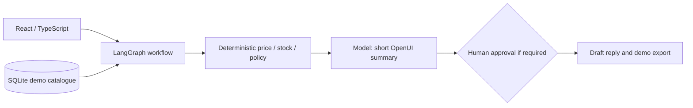
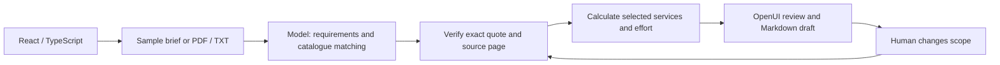

# Two business AI demos you can run yourself

**Built by Petar Vuković.** Two completed, runnable local demo applications that show how AI can help with everyday business work: preparing a sales quote and turning a customer's project brief into a reviewable proposal.

[Hrvatski](README.hr.md) · [Petar's website](https://petarvukovic.tech) · [Source repository](https://github.com/PetarVukovic/ai-agent-showcase)

## 1. AI Operations Desk — from customer request to a checked quote

Checking product availability, delivery dates and discounts by hand slows down a sales reply. Operations Desk gathers those checks in one workspace: choose the product and quantity, see the calculated quote, review an available alternative, and approve or decline a discount that needs a manager's decision.

**Try it:** prepare the sample request for 40 chairs with a 12% discount. Review the quote, approve the discount, then try a request that cannot be fulfilled and select an alternative. Nothing is sent to a customer and no stock is reserved.

- [Application guide](ai-operations-desk/README.md)
- After starting: **http://127.0.0.1:5174**

## 2. AI Proposal Studio — from a long brief to a clear proposal

Important requirements get lost across pages, and a proposal can promise work the team has not actually included. Proposal Studio extracts selected requirements from a project brief, shows the exact supporting passages, flags open questions and lets you include or remove services before exporting a draft.

**Try it:** open the Northstar sample, inspect a source passage, remove the API integration from scope and update the proposal. The sample price changes by €1,800, and the excluded service is visibly marked. Prices are illustrative, not a real commercial offer.

- [Application guide](ai-proposal-studio/README.md)
- After starting: **http://127.0.0.1:5175**
- Two fictional client briefs and their sample PDF/TXT files are included.

Both applications have English and Croatian interfaces. You can explore them with the clearly labelled guided demo without a model key, or configure Gemini/OpenAI for real model processing. You stay in control of the decision and the final draft.

## Run it yourself

These are local applications: you can clone this repository and start either one independently. Publishing this source repository does not deploy the applications or provide a hosted service.

```sh
git clone https://github.com/PetarVukovic/ai-agent-showcase.git
cd ai-agent-showcase
```

## Install

Requirements: Python 3.12, Node.js with npm, and [uv](https://docs.astral.sh/uv/). Use separate terminals for each server. Run the following from a fresh clone's root.

### Operations Desk

```sh
cd ai-operations-desk/backend
uv sync --frozen
cp .env.example .env
cd ../frontend
npm ci
```

### Proposal Studio

From the repository root in another terminal:

```sh
cd ai-proposal-studio
uv venv .venv --python 3.12
uv pip install --python .venv/bin/python -r requirements.lock.txt
cp .env.example .env
cd frontend
npm ci
```

Both applications can run in labelled demo mode without a model key. To use a provider, edit the backend-only `.env` file described below.

## Provider configuration

Operations Desk reads `ai-operations-desk/backend/.env`. Proposal Studio reads `ai-proposal-studio/.env`. Copy the corresponding `.env.example`, then configure only the provider you want:

```dotenv
OPENAI_API_KEY=your-own-key
OPENAI_MODEL=gpt-4.1-mini
GOOGLE_API_KEY=your-own-key
GEMINI_MODEL=gemini-3.5-flash-lite
LANGSMITH_TRACING=false
```

Alternatively, set `PROVIDER_ENV_FILE=/absolute/path/to/provider.env`. The application reads **only `GOOGLE_API_KEY`** from that file; unrelated settings are not imported. Direct `GOOGLE_API_KEY` takes precedence. Proposal Studio also accepts direct `GEMINI_API_KEY`.

Never put provider keys in React code, `VITE_*` variables, screenshots or commits. `.gitignore` excludes local env files, database files, uploaded/private documents and runtime state while retaining `.env.example` and synthetic sample documents. Gemini is selected when available; otherwise choose a configured provider or the labelled guided demo. Provider usage may incur API costs. In provider mode, document/request text is sent to that provider.

## Run all four local processes

From the repository root, open four terminals:

```sh
sh ai-operations-desk/start-backend.sh
```

```sh
sh ai-operations-desk/start-frontend.sh
```

```sh
sh ai-proposal-studio/start-backend.sh
```

```sh
sh ai-proposal-studio/start-frontend.sh
```

API docs are available at each Agent Server's `/docs`. Each frontend also has crawlable English `/about/` and Croatian `/hr/about/` explanatory pages. These are local pages, not evidence of a public deployment.

## Verification

Operations Desk, from `ai-operations-desk/backend`:

```sh
.venv/bin/python -m unittest test_workflow -v
```

Proposal Studio, from `ai-proposal-studio`:

```sh
.venv/bin/pytest -q
```

In either frontend folder:

```sh
npm run build
```

Proposal Studio's `frontend/test-ui.tsx` checks the OpenUI parser contract; run `npx tsx test-ui.tsx` there. Its `scripts/test_http.py` exercises the running HTTP API and makes one real Gemini request; run it deliberately with a configured key. It currently expects Gemini configured and OpenAI unconfigured in that test environment.

The MVPs have been exercised with real Gemini requests, source verification, deterministic pricing, approval/resume, invalid inputs and scope changes. See each app README for details and limits. Test success does not establish production readiness.

## What to keep in mind

The businesses, catalogue records, prices and availability are fictional sample data. Amounts exclude VAT. Estimated effort is not a promised delivery date. Proposal Studio reviews selected requirements rather than every possible condition; always review the original document and the draft. It extracts existing PDF text and does not run OCR.

These applications are demonstrations for local use. They have no production authentication, usage limits or production hosting setup. Real Gemini/OpenAI use may incur API costs and sends the relevant text to the selected provider. Provider failures are visible; they do not silently become guided-demo results.

For a short recording, see [SNIMANJE.md](SNIMANJE.md). Content and search-presentation notes are in [SEO-GEO.md](SEO-GEO.md); no search ranking or AI citation outcome is promised.

<details>
<summary>Technical architecture and the precise role of each agent</summary>

## AI Operations Desk: quote automation with human approval

A customer asks for a product, quantity, delivery deadline and discount. The application reads a **synthetic SQLite catalogue**, checks stock and lead time, calculates the quote, and applies a fixed demo discount policy. Discounts above **8%** require a real LangGraph `interrupt()` and a human approve/reject decision. Approval is bound to the exact quote digest; it cannot override insufficient stock or an impossible deadline.

The model's role is deliberately bounded: Gemini or OpenAI produces a short business summary as OpenUI Lang. **The model does not calculate prices, grant discounts, update stock or place orders.** The reply draft is composed from the validated outcome. Deterministic demo mode supplies a clearly labelled rule-based summary through the same workflow.

Actual graph nodes: `validate_request` → `check_catalog` → `calculate_quote` → `compose_brief` → `review_quote` → `prepare_reply`.



Ready scenarios cover a quote requiring discount approval, an unavailable quantity/deadline, and an available alternative. No order is sent, no email is sent, and no stock is reserved.

## AI Proposal Studio: RFP analysis with citations

Choose a synthetic project brief or upload a text PDF/TXT. The model extracts selected requirements, matches them against a defined service catalogue and proposes clarification questions. Code verifies every displayed **quote and page number** against the actual document. Unverifiable rows are removed and reported.

Catalogue prices and effort are calculated by code. Scope toggles reuse the verified requirements, skip another model call and recalculate the proposal. Requirements belonging to removed services are marked as excluded; stale draft export is blocked until recalculation. The result is a **Markdown proposal draft for human review**, not an automatically sent offer.

Actual graph nodes: `load_document` → `analyze_requirements` → `verify_evidence` → `price_scope` → `build_proposal`. Scope-only runs skip `analyze_requirements`.



Two synthetic scenarios are included: **Northstar**, an internal knowledge workspace, and **Harbor**, a sales workflow assistant. Matching sample PDFs/TXT live in `ai-proposal-studio/frontend/public/samples/`. PyMuPDF extracts existing PDF text; **OCR is not implemented**. AI is asked for up to 12 selected requirements, with a schema hard cap of 15; this is not an exhaustive compliance review.

## How the integration works

- **React + TypeScript** provides the English/Croatian workspace, input controls, source viewer and scope/approval actions.
- **LangGraph Agent Server** exposes each graph through `langgraph dev`, manages thread/checkpoint state and streams actual graph updates to the UI.
- **OpenUI** supplies typed application components and a renderer. Operations Desk asks the model to write a small OpenUI summary against the generated component contract. Proposal Studio validates structured model data and serializes it into a fixed domain-specific OpenUI review layout.
- **Gemini / OpenAI** are called directly from the backend. A gateway is not required. Model failures are shown; there is no silent switch to demo output.
- **SQLite** holds local business data, uploaded documents or finished drafts. It does not replace Agent Server checkpointing. Qdrant is not needed for these bounded MVP workflows.


</details>
